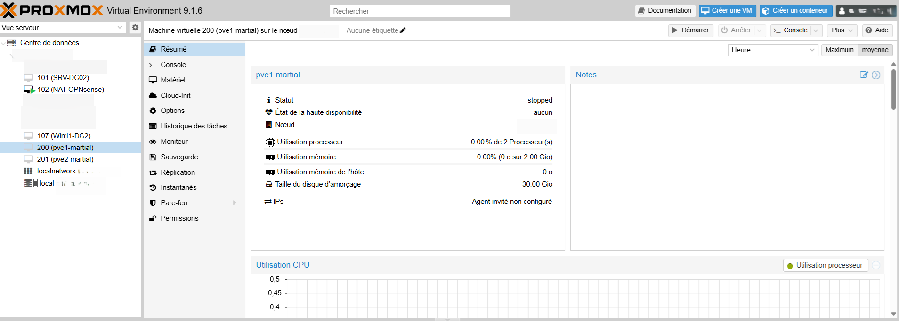

# Projet AIS – Virtualisation avec Proxmox VE

## Présentation
Projet de virtualisation réalisé dans le cadre de ma formation Administrateur d'Infrastructures Sécurisées (AIS) chez O'clock.

## Objectifs du projet
- Installer deux hyperviseurs Proxmox VE en virtualisation imbriquée.
- Configurer les adresses IP fixes.
- Accéder aux interfaces d'administration web.
- Vérifier la communication réseau entre les hyperviseurs.

## Technologies utilisées
- Proxmox VE
- Linux
- Réseaux TCP/IP
- Windows 11
- Virtualisation de type 1

## Réalisations techniques

### Installation des hyperviseurs
- Installation de deux hyperviseurs Proxmox VE en virtualisation imbriquée sur un serveur Proxmox existant.
- Configuration de chaque VM avec 2 cœurs CPU (type host), 2 Gio de RAM et un disque de 30 Go.
- Configuration des cartes réseau VirtIO sur le bridge vmbr3.

### Configuration réseau
| Hyperviseur | Adresse IP privée |
|---|---|
| pve1-martial | 172.16.0.56 |
| pve2-martial | 172.16.0.58 |

### Vérification du fonctionnement
- Démarrage réussi des deux hyperviseurs.
- Accès aux deux interfaces d'administration HTTPS sur le port 8006 depuis Windows 11.
- Vérification de la communication réseau par des tests ping dans les deux sens.
- Résultat : 4 paquets reçus sur 4 dans chaque sens, soit 0 % de perte.

### Bilan
Cet atelier m'a permis de mettre en pratique la virtualisation imbriquée, la configuration des ressources matérielles et la vérification de la connectivité réseau entre deux hyperviseurs.

## Documentation
Les procédures techniques et les captures d'écran de mes réalisations seront ajoutées progressivement.

## Captures d'écran

### Mes deux machines virtuelles Proxmox VE

